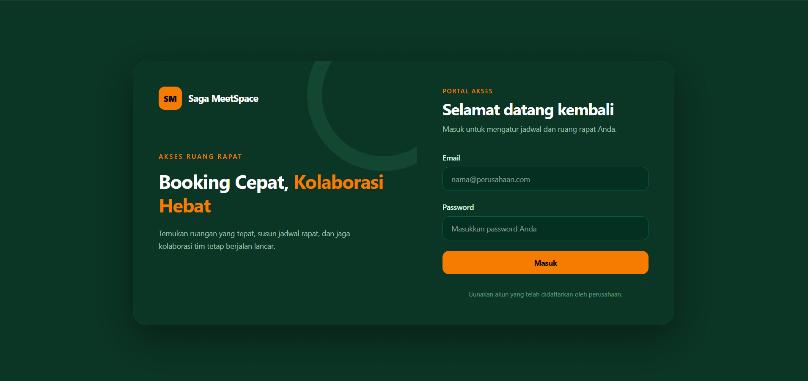
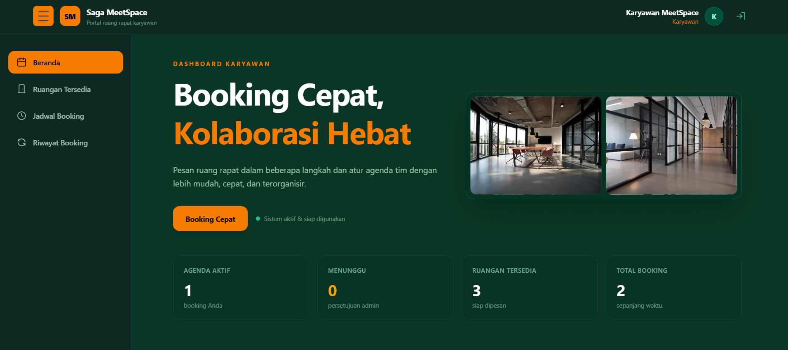
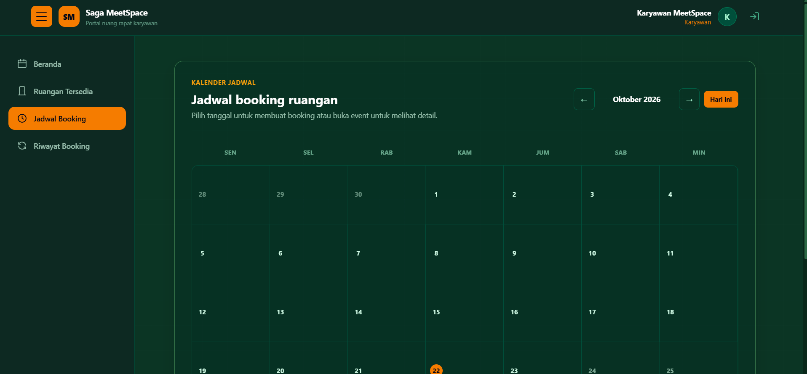
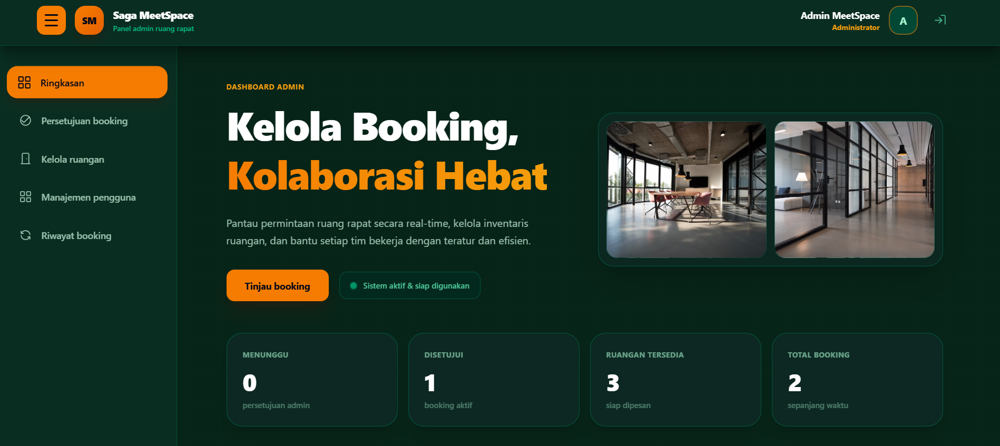

# Saga MeetSpace — Sistem Booking Ruang Rapat

[](https://github.com/Central-Saga/Deny-Project1-BookingRuangRapat/actions/workflows/ci.yml)

Saga MeetSpace adalah aplikasi web untuk pengelolaan pemesanan ruang rapat. Karyawan dapat melihat ketersediaan ruangan, membuat dan mengelola pengajuan pemesanan, serta melihat jadwal dan riwayat. Admin memiliki akses pengelolaan ruangan, akun pengguna, dan persetujuan atau penolakan pengajuan.

> **Lingkungan:** Panduan ini ditujukan untuk pengembangan/demo lokal menggunakan Docker Compose. Akun demo dan nilai konfigurasi contoh **bukan** untuk produksi.

---

## Fitur

**Karyawan**
- Login/logout menggunakan akun karyawan.
- Melihat daftar ruangan dan informasi ketersediaan.
- Membuat, mengubah, atau membatalkan booking sesuai aturan aplikasi.
- Melihat jadwal, status pengajuan, dan riwayat booking.

**Admin**
- Login/logout menggunakan akun administrator.
- Mengelola data ruangan dan pengguna (`/api/v1/users`).
- Meninjau pengajuan booking, menyetujui, atau menolak pengajuan.
- Melihat informasi booking melalui dashboard.

Beberapa tindakan dibatasi oleh role, status booking, dan aturan validasi di backend. Jam operasional yang digunakan oleh antarmuka adalah **08.00–17.00**; ikuti validasi backend saat mengajukan booking.

### Otorisasi (RBAC)

Satu-satunya sumber otorisasi adalah kolom `users.role` (`admin` atau `karyawan`).

| Aksi | Admin | Karyawan |
|------|:-----:|:--------:|
| Melihat ruangan aktif dan ketersediaan | ✅ | ✅ |
| Melihat ruangan nonaktif, membuat/mengubah/menonaktifkan ruangan | ✅ | ❌ |
| Mengelola pengguna (`/api/v1/users`) | ✅ | ❌ |
| Membuat booking | ✅ | ✅ |
| Melihat booking | semua | milik sendiri |
| Mengubah/menghapus booking | hanya milik sendiri | hanya milik sendiri |
| Membatalkan booking | semua | milik sendiri |
| Menyetujui/menolak booking | ✅ | ❌ |

---

## Teknologi

| Komponen | Teknologi |
| --- | --- |
| Frontend | Next.js 16 (App Router), React 19, TypeScript, Tailwind CSS |
| Backend | Laravel 11 / PHP 8.3, Laravel Sanctum |
| Database | PostgreSQL 16 (SQLite in-memory untuk testing) |
| Lingkungan lokal | Docker dan Docker Compose |

---

## Struktur Repository

```text
.
├── backend/                  # API Laravel, migrasi, seeder, dan tests
│   ├── app/                  # Controller, Models, Services, Rules
│   ├── database/seeders/     # DatabaseSeeder dan RoomSeeder
│   ├── .env.example          # Template environment Laravel
│   ├── README.md             # Dokumentasi modul backend
│   └── Dockerfile
├── frontend/                 # Aplikasi Next.js
│   ├── src/app/              # Halaman aplikasi
│   ├── src/components/       # Komponen dashboard, booking, admin
│   ├── src/api/              # Centralized API client & cache layer
│   ├── src/shared/ui/        # Komponen presentasional murni
│   ├── README.md             # Dokumentasi modul frontend
│   └── Dockerfile
├── docs/                     # Dokumentasi arsitektur, PRD, dan openapi.yaml
├── shared/ui/                # Presentational UI export
├── .env.example              # Template variabel Docker Compose
├── docker-compose.yml
└── README.md
```

---

## Persyaratan Sistem

- Git
- Docker Desktop (Windows/macOS) atau Docker Engine dengan plugin Docker Compose (Linux)
- Port lokal **3000**, **8000**, dan **5432** tersedia

Node.js, PHP, dan PostgreSQL **tidak perlu diinstal di host** jika menggunakan Docker Compose.

---

## Cara Menjalankan dari Nol (Quick Start)

Panduan langkah demi langkah berikut menjamin aplikasi dapat di-*boot* dan dijalankan dari awal (*fresh environment*) dengan standar waktu **≤ 15 menit sampai login** (estimasi aktual: 2–3 menit).

### 1. Clone repository dan masuk ke direktori proyek

```bash
git clone https://github.com/Central-Saga/Deny-Project1-BookingRuangRapat.git
cd Deny-Project1-BookingRuangRapat
```

### 2. Siapkan konfigurasi environment (.env)

Salin template environment untuk root Compose dan backend Laravel:

```bash
# Linux / macOS / Bash
cp .env.example .env
cp backend/.env.example backend/.env
```

*(Untuk Windows PowerShell: `Copy-Item .env.example .env` dan `Copy-Item backend/.env.example backend/.env`)*

### 3. Build dan jalankan seluruh container

```bash
docker compose up -d --build
```

Pastikan seluruh service berstatus running dan database healthy:

```bash
docker compose ps
```

### 4. Buat Application Key Laravel

```bash
docker compose exec -T backend php artisan key:generate --force
```

### 5. Jalankan migrasi database dan isi data demo (Seeding)

```bash
docker compose exec -T backend php artisan migrate --seed --force
```

Perintah di atas mengeksekusi migrasi skema tabel PostgreSQL dan mengisi data awal berupa ruangan serta akun pengujian (`admin@example.com` dan `karyawan@example.com`).

### 6. Akses aplikasi dan login

Buka peramban (browser) dan akses alamat berikut:

| Layanan | Alamat Akses | Keterangan |
| --- | --- | --- |
| **Aplikasi Web (Form Login)** | **http://localhost:3000** | Form login tersedia langsung di halaman utama `/` |
| **Backend REST API** | **http://localhost:8000/api** | Endpoint dasar API |
| **Spesifikasi OpenAPI** | [docs/openapi.yaml](docs/openapi.yaml) | Dokumentasi OpenAPI 3.1 |

---

## Akun Demo Pengujian

Akun berikut dibuat otomatis saat proses seeder:

| Hak Akses (Role) | Email | Password | Hak Akses Utama |
|---|---|---|---|
| **Admin** | `admin@example.com` | `password` | Manajemen ruangan, pengguna, dan persetujuan pengajuan booking |
| **Karyawan** | `karyawan@example.com` | `password` | Melihat jadwal ruangan, membuat booking rapat, membatalkan booking sendiri |

> **Catatan Keamanan:** Akun bawaan ini hanya untuk keperluan demo dan pengujian lokal. Ganti kredensial atau nonaktifkan sebelum deployment ke server publik. Password default dikonfigurasi melalui variabel `SEED_PASSWORD` (default: `password`).

---

## Cara Menjalankan Secara Lokal (Tanpa Docker)

Jika Anda ingin menjalankan frontend dan backend secara native pada host:

### A. Menjalankan Backend Laravel
```bash
cd backend
cp .env.example .env
composer install
php artisan key:generate
php artisan migrate --seed --force
php artisan serve --port=8000
```

### B. Menjalankan Frontend Next.js
```bash
cd frontend
cp .env.example .env.local
npm install
npm run dev
```

Aplikasi web dapat diakses di [http://localhost:3000](http://localhost:3000).

---

## Screenshot Aplikasi

Berikut tampilan antarmuka Saga MeetSpace saat dijalankan:

### 1. Halaman Login


### 2. Dashboard Karyawan


### 3. Form Booking Ruang Rapat


### 4. Dashboard Admin


---

## Perintah Docker yang Berguna

```bash
# Cek status seluruh service
docker compose ps

# Melihat log seluruh service
docker compose logs -f --tail=100

# Melihat log backend saja
docker compose logs -f --tail=100 backend

# Menghentikan container (data volume database tetap tersimpan)
docker compose down

# Menghentikan dan menghapus volume database (jika ingin reset total)
docker compose down -v
```

---

## Troubleshooting

| Masalah | Solusi |
| --- | --- |
| Port 3000, 8000, atau 5432 sudah digunakan | Hentikan proses yang memakai port tersebut atau ubah port pada `docker-compose.yml`. |
| Database connection error | Pastikan container `db` healthy dengan `docker compose ps`, lalu periksa `DB_PASSWORD` di `.env`. |
| `APP_KEY` belum disetel | Jalankan `docker compose exec -T backend php artisan key:generate --force`. |
| Halaman `/login` menampilkan 404 | Akses langsung [http://localhost:3000/](http://localhost:3000/) (halaman root memuat form login). |

---

## Pengujian Otomatis

- **Backend Tests (PHPUnit):**
  ```bash
  cd backend
  php artisan test
  ```
- **Frontend Tests (Vitest):**
  ```bash
  cd frontend
  npm test
  ```

---

**Repository:** https://github.com/Central-Saga/Deny-Project1-BookingRuangRapat
