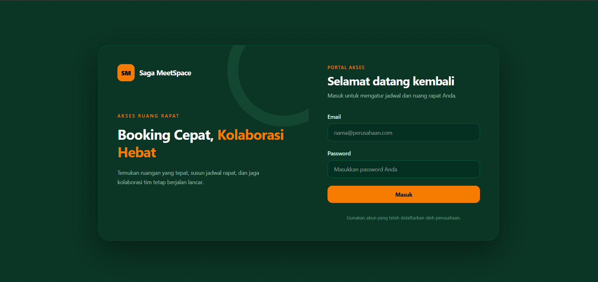
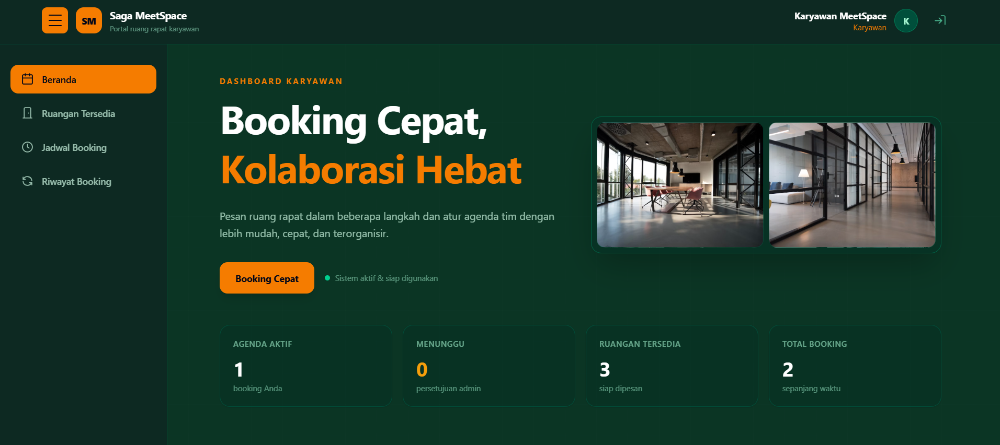
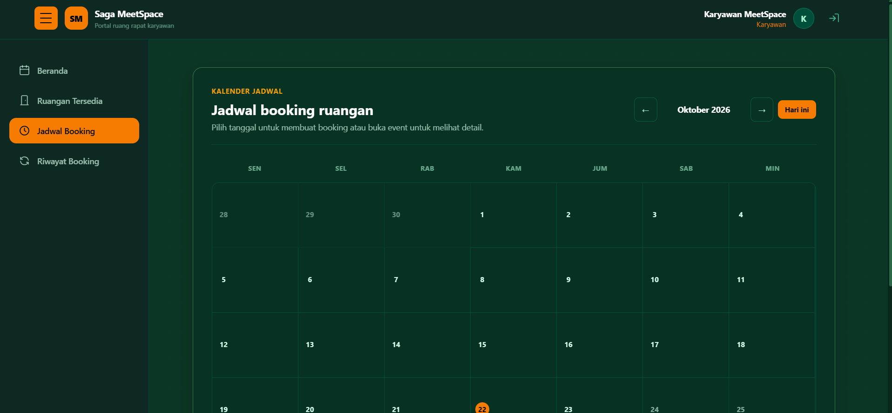
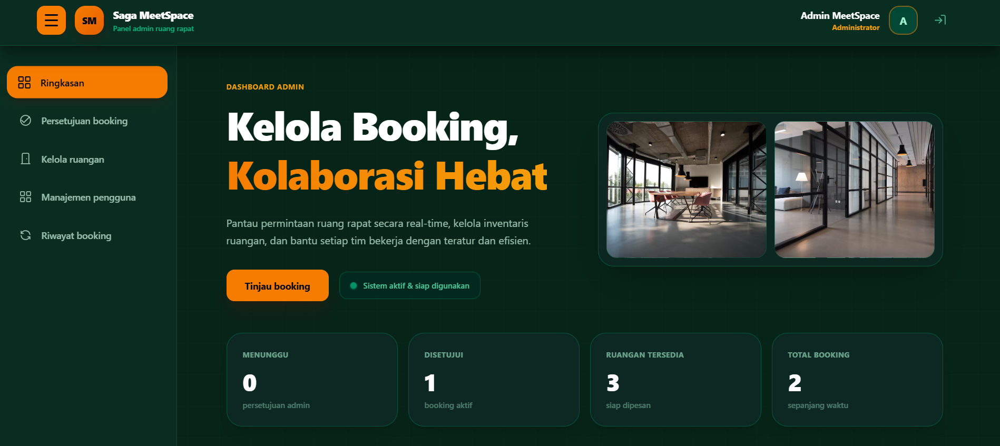

# Saga MeetSpace — Sistem Booking Ruang Rapat

Saga MeetSpace adalah aplikasi web untuk pengelolaan pemesanan ruang rapat. Karyawan dapat melihat ketersediaan ruangan, membuat dan mengelola pengajuan pemesanan, serta melihat jadwal dan riwayat. Admin memiliki akses pengelolaan ruangan, akun pengguna, dan persetujuan atau penolakan pengajuan.

> **Lingkungan:** Panduan ini ditujukan untuk pengembangan/demo lokal menggunakan Docker Compose. Akun demo dan nilai konfigurasi contoh **bukan** untuk produksi.

## Fitur

**Karyawan**

- Login/logout menggunakan akun karyawan.
- Melihat daftar ruangan dan informasi ketersediaan.
- Membuat, mengubah, atau membatalkan booking sesuai aturan aplikasi.
- Melihat jadwal, status pengajuan, dan riwayat booking.

**Admin**

- Login/logout menggunakan akun administrator.
- Mengelola data ruangan dan pengguna.
- Meninjau pengajuan booking, menyetujui, atau menolak pengajuan.
- Melihat informasi booking melalui dashboard.

Beberapa tindakan dibatasi oleh role, status booking, dan aturan validasi di backend. Jam operasional yang digunakan oleh antarmuka adalah **08.00–17.00**; ikuti validasi backend saat mengajukan booking.

## Teknologi

| Komponen | Teknologi |
| --- | --- |
| Frontend | Next.js 16.3.4, React 19, TypeScript, Tailwind CSS 4 |
| Backend | Laravel / PHP 8.3, Laravel Sanctum |
| Database | PostgreSQL 16 |
| Lingkungan lokal | Docker dan Docker Compose |

## Struktur repository

```text
.
├── backend/                  # API Laravel, migrasi, seeder, dan tests
│   ├── database/seeders/     # DatabaseSeeder dan RoomSeeder
│   ├── .env.example          # Template environment Laravel
│   └── Dockerfile
├── frontend/                 # Aplikasi Next.js
│   ├── src/app/              # Halaman aplikasi
│   ├── src/components/       # Komponen dashboard, booking, admin
│   └── Dockerfile
├── .env.example              # Template variabel Docker Compose
├── docker-compose.yml
└── README.md
```

## Persyaratan

- Git.
- Docker Desktop (Windows/macOS) atau Docker Engine dengan plugin Docker Compose (Linux).
- Port lokal **3000**, **8000**, dan **5432** tersedia, atau disesuaikan pada `docker-compose.yml`.

Node.js, PHP, dan PostgreSQL **tidak perlu diinstal di host** jika menggunakan Docker Compose.

## Cara menjalankan dari fresh clone

Panduan utama di bawah menggunakan **PowerShell (Windows)**. Untuk macOS/Linux, gunakan `cp` sebagai pengganti `Copy-Item`.

### 1. Clone repository

```powershell
git clone https://github.com/Central-Saga/Deny-Project1-BookingRuangRapat.git
cd Deny-Project1-BookingRuangRapat
```

> Nama direktori dapat berbeda apabila Anda meng-clone ke folder dengan nama pilihan sendiri.

### 2. Siapkan konfigurasi environment

```powershell
Copy-Item .env.example .env
Copy-Item backend/.env.example backend/.env
```

Gunakan editor teks untuk menyesuaikan kedua file berikut:

- **`.env` di root repository:** atur `DB_PASSWORD` menjadi password database **lokal** pilihan Anda; `DB_USERNAME`, `DB_DATABASE`, dan `NEXT_PUBLIC_API_URL` dapat dibiarkan sesuai contoh untuk demo lokal.
- **`backend/.env`:** biarkan `DB_HOST=db`, `DB_PORT=5432`, `DB_CONNECTION=pgsql`, dan atur `APP_ENV=local`, `APP_DEBUG=true` hanya untuk pengembangan. Variabel database yang ditetapkan Compose akan diteruskan ke container backend. Nilai `APP_KEY` akan dibuat pada langkah berikutnya.

**Penting:** Root `.env` dipakai Docker Compose untuk substitusi variabel database. `backend/.env` dipakai untuk konfigurasi Laravel melalui `env_file`. Jangan berasumsi root `APP_KEY` dipakai Laravel. Jangan commit file `.env` atau menggunakan akun/password demo di server publik.

### 3. Buat APP_KEY Laravel

Saat file `backend/.env` masih memiliki `APP_KEY=` kosong, jalankan:

```powershell
docker compose run --rm -T backend php artisan key:generate --show
```

Perintah ini mengeluarkan satu nilai yang dimulai dengan `base64:`. Salin **hanya nilai tersebut** ke baris `APP_KEY=` pada **`backend/.env`** (contoh format: `APP_KEY=base64:...`). Jangan membagikan nilai key kepada orang lain.

> Perintah `docker compose run` bisa memulai service PostgreSQL sesuai dependency. File `.env` lokal tidak ikut disalin ke Docker image karena aturan `.dockerignore`.

### 4. Build dan jalankan aplikasi

```powershell
docker compose up -d --build
docker compose ps
```

Pastikan service `db` berstatus healthy dan service `backend` serta `frontend` berjalan. Build pertama membutuhkan waktu lebih lama daripada start berikutnya.

### 5. Migrasi database dan isi data demo

```powershell
docker compose exec -T backend php artisan migrate --force
docker compose exec -T backend php artisan db:seed --force
```

Seeder mengisi akun demo serta tiga ruangan awal: **Ruang Rapat Utama**, **Ruang Diskusi**, dan **Jineng Meet**. Perintah `db:seed` menggunakan `updateOrCreate` untuk data tersebut dan dapat memperbarui password akun demo; jalankan hanya pada lingkungan pengembangan/demo.

### 6. Buka aplikasi

| Service | Alamat |
| --- | --- |
| Aplikasi web / formulir login | http://localhost:3000 |
| Backend API | http://localhost:8000/api |
| Endpoint login API | `POST http://localhost:8000/api/login` |

**Gunakan halaman `/` untuk login**, bukan `/login` (tidak ada page Next.js terpisah di route tersebut pada struktur project yang diaudit).

## Akun demo

Akun berikut dibuat oleh `backend/database/seeders/DatabaseSeeder.php` saat `db:seed` dijalankan.

| Hak akses | Email | Password |
| --- | --- | --- |
| Admin | `admin@example.com` | `password` |
| Karyawan | `karyawan@example.com` | `password` |

**Hanya untuk demo lokal.** Jangan mengekspos sistem yang memakai kredensial bawaan ini ke internet; ubah/nonaktifkan akun demo sebelum deployment publik.

## Panduan singkat penggunaan

1. Buka `http://localhost:3000` lalu login sebagai karyawan.
2. Lihat daftar ruangan dan jadwal, pilih waktu yang tersedia, kemudian ajukan booking.
3. Tinjau status booking pada dashboard atau riwayat; lakukan perubahan atau pembatalan bila diizinkan sistem.
4. Logout, login sebagai admin, lalu tinjau dan proses pengajuan booking.
5. Gunakan menu admin untuk mengelola data ruangan/pengguna sesuai hak akses.

## Screenshot aplikasi

Berikut tampilan aplikasi Saga MeetSpace yang dijalankan secara lokal.

### 1. Halaman Login



### 2. Dashboard Karyawan



### 3. Form Booking Ruang Rapat



### 4. Dashboard Admin



## Perintah Docker yang berguna

```powershell
# Status service
docker compose ps

# Log seluruh service
docker compose logs --tail=100

# Log backend saja
docker compose logs --tail=100 backend

# Log frontend saja
docker compose logs --tail=100 frontend

# Hentikan container, pertahankan volume database
docker compose down

# Jalankan kembali tanpa build jika image tersedia
docker compose up -d
```

**Jangan jalankan `docker compose down -v`** kecuali benar-benar ingin menghapus data yang tersimpan dalam volume PostgreSQL.

## Troubleshooting

| Masalah | Pemeriksaan/solusi |
| --- | --- |
| Docker Engine tidak dapat dihubungi | Jalankan Docker Desktop, lalu coba `docker info`. |
| Port 3000, 8000, atau 5432 sudah digunakan | Bebaskan port atau sesuaikan mapping `ports:` pada Compose. |
| `APP_KEY` belum disetel | Buat key dengan langkah 3, isi `backend/.env`, lalu recreate service backend agar environment baru terbaca. |
| Koneksi database gagal | Pastikan `docker compose ps` menunjukkan `db` healthy, cek `DB_PASSWORD` root `.env`, lalu periksa `docker compose logs backend db`. |
| Tabel belum tersedia | Jalankan `docker compose exec -T backend php artisan migrate --force`. |
| Akun demo tidak ada | Jalankan `docker compose exec -T backend php artisan db:seed --force` pada database demo. |
| `http://localhost:3000/login` menampilkan 404 | Akses `http://localhost:3000/`; form login merupakan bagian dari halaman utama. |
| Muncul peringatan `next start` terkait `standalone` | Periksa `frontend/next.config.ts` dan `frontend/Dockerfile`. Peringatan tersebut perlu ditangani dalam perbaikan konfigurasi frontend; status container *Running* saja belum membuktikan semua halaman bekerja. |

Untuk memeriksa konfigurasi Compose tanpa memaparkan password hasil substitusi:

```powershell
docker compose config --quiet
```

## Keamanan dan catatan deployment

- `.env` dan `backend/.env` adalah file privat; jangan commit atau bagikan isinya.
- `.env.example` berisi contoh/placeholder, bukan kunci atau password aktif.
- `.dockerignore` backend mengecualikan `.env` agar rahasia lokal tidak disalin oleh `COPY . .` ke image.
- Ganti kredensial dan nonaktifkan akun demo sebelum deployment publik.
- Konfigurasi Compose di repository ini ditujukan untuk **demo/pengembangan lokal**, belum otomatis merupakan konfigurasi produksi yang aman.

## Pengujian dan pengembangan

Backend menyimpan pengujian Laravel pada `backend/tests/`. Contoh menjalankan tes dari container backend:

```powershell
docker compose exec -T backend php artisan test
```

Periksa konfigurasi database pengujian sebelum menjalankan test; jangan gunakan database berisi data penting. Frontend dapat dicek melalui build Docker atau perintah npm di direktori `frontend` jika Node.js tersedia pada host.

---

**Repository:** https://github.com/Central-Saga/Deny-Project1-BookingRuangRapat
